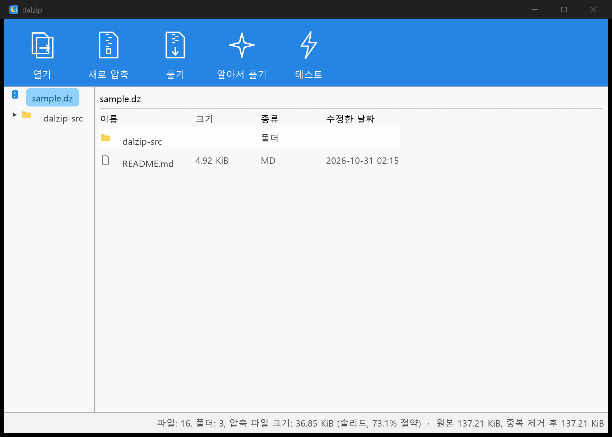
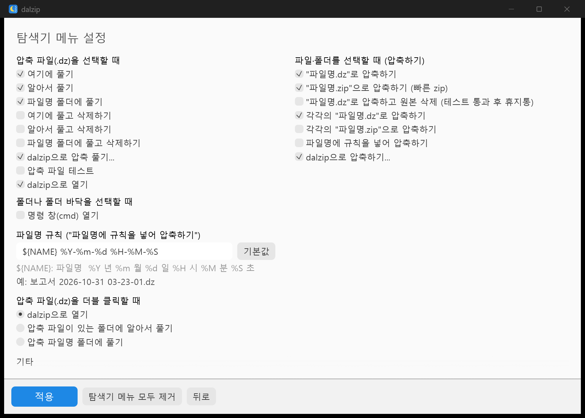
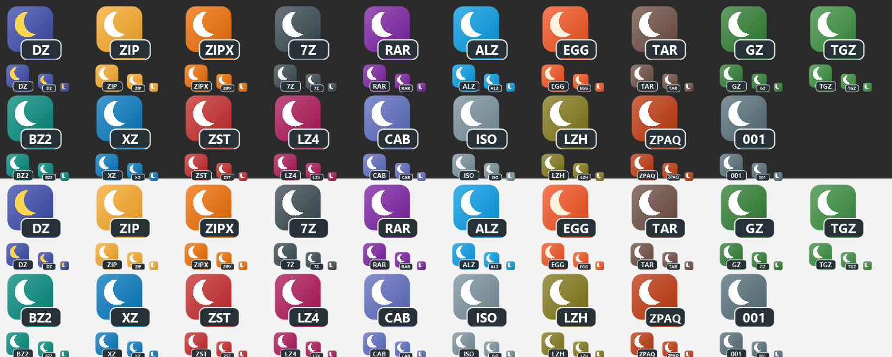
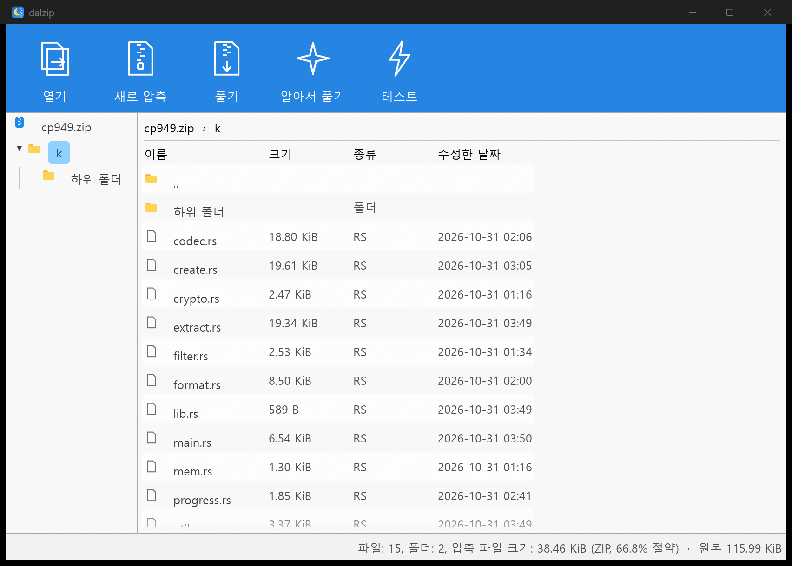

# dalzip (`dz`)

Rust로 만든 솔리드 아카이버. 반디집 7.47의 압축 엔진(Ark)을 REA + Ghidra로 분석해 동작과 정책을
파악한 뒤, 그보다 한 단계 나아간 압축 방식을 넣어 새로 만들었다. UI와 탐색기 연결도 반디집 구조를 분석해
같은 흐름으로 다시 만들었다. 디컴파일한 코드는 옮기지 않았다.
분석 메모: 엔진 [docs/bandizip-notes.md](docs/bandizip-notes.md), UI·탐색기 [docs/bandizip-ui-shell-notes.md](docs/bandizip-ui-shell-notes.md).

| 구성 | 파일 | 역할 |
|---|---|---|
| 엔진 | `src/lib.rs` (crate `dalzip`) | 압축·해제·암호·진행률/취소 |
| CLI | `dz.exe` | `c` / `x` / `t` / `l` / `z`(ZIP) |
| GUI | `dzui.exe` (egui) | 시작 화면, 아카이브 탐색, 새로 압축, 풀기, 진행 창 |
| 탐색기 메뉴 | `dz_shell.dll` (COM, `shell/`) | 우클릭 메뉴(IExplorerCommand) |

## 반디집 대비 무엇이 다른가

| | 반디집 7.47 (Ark) | dalzip |
|---|---|---|
| 중복 제거 | ZPAQ 포맷에서만 (느림) | 모든 레벨: FastCDC 가변 청크(16–256 KiB) + BLAKE3 |
| 병렬화 | LZMA2-MT: 블록을 독립으로 잘라 문맥이 끊김 | **히스토리 체인**: 작은 블록을 병렬 압축하되, 각 블록에 같은 체인의 앞 데이터를 프리셋 사전으로 넣어 문맥 유지 |
| 코덱 선택 | 포맷/레벨마다 하나 고정 | 블록마다: 압축 가능성 샘플 검사 → 저장 / zstd / LZMA2 / PPMd, L7+는 전부 시도해 가장 작은 것 |
| LZMA2 튜닝 | 레벨별 프리셋 | 블록 종류별(텍스트는 lc=4·pb=0), raw LZMA2 스트림 |
| 실행 파일 | 7z의 BCJ/BCJ2 | BCJ식 E8/E9 필터 + L7+에서 필터 효과 검증 |
| PPMd | 디코더만 있음(인코더 없음) | PPMd var.I 인코더, L7+ 후보 |
| 해제 | 순차 | 체인 단위 병렬 디코드 + 파일 병렬 쓰기 |
| 스레드 | CPU 수 → 메모리 80% 넘으면 감소 | 같은 정책(분석에서 가져옴) |
| 암호 | ZipCrypto, AES, LEA | Argon2id + XChaCha20-Poly1305, 파일명까지 암호화, 블록 단위 인증 |
| 무결성 | CRC32 | 블록·파일마다 BLAKE3 |

## 사용법

```
dz c <archive.dz> <파일/폴더...> [-l 0-9] [-t N] [-p 암호] [--no-dedup] [--block-mb N]
dz x <archive.dz> [-o 폴더] [-p 암호] [-y]
dz t <archive.dz> [-p 암호]
dz l <archive.dz> [-p 암호]
dz z <archive.zip> <파일/폴더...> [-l 0-11]     ZIP 만들기 (병렬 deflate, Zip64, UTF-8 이름)
```

ZIP 레벨: 0 저장, 1–9 zlib-rs, **10 libdeflate-12**, 11 Zopfli. 10·11은 파일 전체를 메모리에 올려야 해서
32 MiB 넘는 파일은 zlib 9로 스트리밍한다. 코퍼스 A(117.6 MiB)에서:

| ZIP | 크기 | 비율 | 시간 |
|---|---|---|---|
| dz z -l 6 (빠른 zip 기본) | 36.87 MiB | 31.3% | 0.4초 |
| 반디집 zip -l:5 | 36.66 MiB | 31.2% | 1.8초 |
| dz z -l 9 | 36.00 MiB | 30.6% | 0.8초 |
| 반디집 zip -l:9 | 36.10 MiB | 30.7% | 3.6초 |
| 7-Zip zip -mx9 | 34.87 MiB | 29.6% | 4.6초 |
| **dz z -l 10 (libdeflate)** | **34.76 MiB** | **29.6%** | **2.5초** |
| dz z -l 11 (Zopfli) | 34.74 MiB | 29.5% | 62.3초 |
| 반디집 zip -l:9 -zopfli | 34.83 MiB | 29.6% | 378.1초 |

| 레벨 | 방식 | 블록 / 프리셋 사전 |
|---|---|---|
| 0 | 저장 | 64 MiB / – |
| 1–3 | zstd 3 / 9 long / 19 long | 4–8 MiB / 4–16 MiB |
| 4 | LZMA2-6, 블록 종류별 파라미터 | 8 / 4 MiB |
| 5 (기본) | LZMA2-6 | 8 / 8 MiB |
| 6 | LZMA2-9e | 16 / 32 MiB |
| 7 | LZMA2-9e(필터 유무·텍스트 튜닝) / PPMd 중 최소 | 32 / 32 MiB |
| 8 | 7과 같은 후보 | 64 / 64 MiB |
| 9 | 8 + zstd-19 + PPMd o16 | 64 / 192 MiB |

블록·사전 크기는 코퍼스 A에서 크기 대 시간을 쓸어 보고 정했다. 문맥 길이(사전 + 블록)가 압축률을 정하고,
사전은 블록마다 코덱이 다시 색인해야 해서 시간이 든다. 체인은 원본 256 MiB까지로 끊어서, 아카이브 중간
파일 하나를 꺼낼 때 풀어야 하는 양에 상한을 둔다.

`DZ_DEBUG=1`을 켜면 블록마다 후보 코덱의 크기를 출력한다.

## GUI (`dzui.exe`)

반디집 화면 구성을 따른다: 파란 시작 화면에 큰 타일 2개, 아카이브 창은 파란 툴바(선 아이콘) + 왼쪽 폴더 트리 +
파일 목록 + 상태 표시줄, "새로 압축"은 파일 목록·이름·저장 폴더·레벨·중복 제거·테스트·암호. 파일을 창에 끌어다
놓으면 `.dz`는 열고 나머지는 새 압축에 넣는다. 작업은 진행률·속도·남은 시간·중지 버튼이 있는 창에서 돈다.
기존 파일과 겹치면 "덮어쓰고 다시 풀기"를 묻는다.



셸이 넘기는 명령(반디집의 `bc` / `bx -target:` 프로토콜과 같은 역할):

```
dzui <archive.dz>                                       열기
dzui c [--list F] [경로...]                              새로 압축 대화상자 (DZ / ZIP 선택)
dzui cq [--format zip] [--delete] [--rule] [...]        바로 <이름>.dz|.zip / 원본 삭제 / 날짜 이름
dzui ce [--format zip] [...]                             각각 압축
dzui x --target here|name|auto|dlg [--delete] [...]     풀기 / 풀고 삭제
dzui t [...]                                             테스트
dzui settings                                            탐색기 메뉴 설정
dzui --register | --unregister [--silent]                탐색기 연결 (HKCU만)
```

"삭제"는 반디집과 달리 휴지통으로 보낸다. "압축하고 원본 삭제"는 만든 아카이브를 끝까지 테스트한 뒤에만 지운다.

## 탐색기 연결

`dzui --register`(또는 설정 화면의 "적용")가 HKCU에만 쓴다. 관리자 권한은 필요 없고 `--unregister`로 전부 지워진다.
메뉴 항목·문구·단축키는 반디집 셸 메뉴(`langs\Korean.lang [SHELL]`)와 설정 페이지(`IDD_SETTING_SHELL`)를 따른다.

| 선택 | 항목 (기본으로 켜진 것은 **굵게**) |
|---|---|
| `.dz` 아카이브 | **여기에 풀기(&X)**, **알아서 풀기(&Z)**, **`<이름>\ 에 풀기(&E)`**, 여기에/알아서/파일명 폴더에 풀고 삭제하기, **dalzip으로 압축 풀기(&B)...**, 압축 파일 테스트(&T), **dalzip으로 열기**. 여러 개면 "각각 알아서 풀기", "각각 파일명 폴더에 풀기" |
| 파일·폴더 | **`<이름>.dz 로 압축하기(&Q)`**, **`<이름>.zip 으로 압축하기(&Z)`**(빠른 zip), `<이름>.dz 로 압축하고 원본 삭제`, **각각 파일명.dz로 압축하기(&U)**, 각각 파일명.zip으로 압축하기, `<이름 2026-10-31 03-20-58>.dz 로 압축하기`(파일명 규칙), **dalzip으로 압축하기(&L)...** |
| 폴더·폴더 바닥 | 명령 창 열기(&C) — 반디집처럼 `cmd.exe /s /k pushd "%V"` |

`<이름>`은 반디집과 같다: 하나면 그 이름, 여러 개면 들어 있는 폴더 이름. "각각"은 2개 이상 고를 때만 나온다.

- 구조: 항목마다 정적 verb + `ExplorerCommandHandler`/`CommandStateHandler`(+`CommandStateSync`) = `dz_shell.dll`의
  COM 클래스 하나. `IInitializeCommand`로 받은 키 이름(`dalzip.NN_<id>`)으로 항목을 구분하고, 선택 전체를
  `IShellItemArray`로 받아 `%TEMP%`의 목록 파일로 `dzui.exe`에 넘긴다(반디집은 공유메모리 `/usemmf`).
  명령 창은 선택을 받을 필요가 없어(폴더 바닥 클릭엔 선택이 없음) 일반 명령 verb로 등록한다.
- 기본은 반디집처럼 메뉴에 바로 나오는 평면 배치, 설정에서 계단식(하위 메뉴 "dalzip")으로 바꿀 수 있다.
- `.dz` 확장자: 아이콘, 더블클릭 동작(열기 / 알아서 풀기 / 파일명 폴더에 풀기 — 설정에서 선택).



### 파일 형식 아이콘

반디집(`icons\default\*.ico`, 20종)처럼 형식마다 아이콘을 둔다. 배치는 반디집과 같고(로고 + 오른쪽 아래 확장자 배지)
그림은 dalzip 것이다: 형식의 상징색 타일 + 초승달 + 어두운 배지, 배지 밑줄도 같은 색. 16 px에는 배지 없이 색과 달만.



- 19종(dz zip zipx 7z rar alz egg tar gz tgz bz2 xz zst lz4 cab iso lzh zpaq 001)을 `assets/make_type_icons.ps1`이
  16–256 px `.ico`로 만들고, `build.rs`가 `dzui.exe`에 리소스 ID 101부터 넣는다(`.dz` = `dzui.exe,-101`).
- `.dz`는 기본 연결(`dzui.exe,-101`). `.zip`은 아래처럼 "연결 프로그램"에만 올린다(`-102`). 나머지 17종은 dalzip이
  아직 열 수 없는 형식이라 넣어만 두었다.

### ZIP 열기·풀기

`.zip`도 아카이브 창에서 열고(폴더 트리·목록·상태 표시줄 "ZIP, N% 절약"), 풀기·알아서 풀기·테스트·풀고 삭제가 되며,
탐색기 메뉴의 풀기 항목도 `.zip`에서 나온다. 읽기는 zip 크레이트(deflate, deflate64, bzip2, LZMA, zstd, PPMd, xz,
ZipCrypto·WinZip AES, Zip64)이고, 그 위에 반디집처럼:

- UTF-8 표시가 없고 UTF-8도 아닌 이름은 CP949(한국어 Windows zip)로 읽는다. `\` 구분자는 `/`로 바꾼다.
- 모든 경로가 .dz와 같은 탈출 검사(`..`, 절대 경로, 드라이브 문자)를 거친다. 심볼릭 링크 항목은 건너뛴다.
- 항목을 병렬로 풀고(작업자마다 파일 핸들 하나), 항목마다 CRC-32를 확인한다. 이름은 암호화되지 않으므로 암호 걸린
  zip도 목록은 바로 보이고 풀 때 암호를 묻는다.

`.zip`의 기본 프로그램은 바꾸지 않는다. 사용자가 고른 값(`UserChoice`, 해시로 보호)이 있으면 Windows가 그것을 쓰기
때문이다. 대신 `HKCU\Software\Classes\.zip\OpenWithProgids`에 `dalzip.zip`을 올려 "연결 프로그램" 목록에 나오게 하고,
기본으로 쓰려면 사용자가 "연결 프로그램 → 다른 앱 선택 → dalzip → 항상"을 고르면 된다.

검증한 zip: 반디집, 7-Zip(Deflate64·BZip2·LZMA·PPMd), 7-Zip AES-256·ZipCrypto(틀린 암호·암호 없음 오류 포함),
7-Zip 로컬 코드페이지 이름, .NET `Compress-Archive` — 모두 테스트 통과, 푼 파일 해시 전부 일치. zstd 방식 zip은 설치된
7-Zip이 만들지 못해 시험하지 않았다.



Windows 11에서는 "더 많은 옵션 표시"(클래식 메뉴) 안에 나온다. 첫 화면 메뉴에 올리려면 반디집처럼 서명된 sparse
MSIX 패키지가 필요하다(DLL은 이미 그 경로가 쓰는 IExplorerCommand라 패키징만 하면 됨). 인증서를 신뢰 저장소에
넣는 일이라 하지 않았다.

검증: `shell/examples/harness.rs`(Explorer처럼 COM으로 로드해 제목·표시 여부·실행 확인),
`shell/examples/menu_dump.rs`(셸이 실제로 만드는 컨텍스트 메뉴를 덤프 — 여러 개 선택, `--bg`로 폴더 바닥 메뉴).
`shell/examples/run_harness.ps1`이 모든 항목을 켜고 등록 → 6가지 선택의 메뉴 덤프 → 새 동작 실행 → 기본값 복원까지 한다.
Claude 앱 컨테이너 밖에서 돌려야 실제 HKCU를 본다.

빌드 주의:
- `cargo build -p dz_shell --examples`는 DLL 자체를 다시 만들지 않는다. `--lib --examples`로 빌드할 것.
- 탐색기가 한 번 메뉴를 열면 `dz_shell.dll`을 잡고 있어서, DLL을 다시 빌드하려면 탐색기를 재시작하거나 로그오프해야 한다.

## 포맷

`header | blocks… | index | footer`. 인덱스(zstd 압축, 암호화 시 봉인)에 블록 표(블록마다 프리셋 사전 길이 포함),
청크 표(블록 내 오프셋은 길이로부터 유도), 엔트리가 들어간다. 자세한 레이아웃은 [src/format.rs](src/format.rs) 맨 위 주석.

## 벤치마크 (2026-10-31, 16스레드, RAM 62 GB)

`bench/bench.ps1`로 측정. 크기 단위 MiB, 시간은 초(벽시계, 압축/해제).

**코퍼스 A** — node_modules + 반디집 설치 폴더 + 소스, 6,671개 파일 117.6 MiB

| 도구 | 크기 | 비율 | 압축 | 해제 |
|---|---|---|---|---|
| Bandizip zip -l:5 | 36.66 | 31.2% | 1.9 | 1.3 |
| Bandizip 7z -l:5 (기본) | 17.21 | 14.6% | 8.2 | 1.9 |
| Bandizip 7z -l:9 | 16.19 | 13.8% | 15.6 | 1.9 |
| dz -l 1 | 24.55 | 20.9% | **1.4** | **0.6** |
| dz -l 3 | 17.51 | 14.9% | 6.4 | 0.7 |
| dz -l 5 (기본) | 16.86 | 14.3% | 5.7 | 0.9 |
| dz -l 6 | 16.17 | 13.7% | 15.0 | 0.9 |
| dz -l 7 | 15.97 | 13.6% | 21.9 | 0.9 |

**코퍼스 B** — 코퍼스 A의 백업 두 벌(v2는 JS 300여 개 수정), 13,342개 파일 235.3 MiB

| 도구 | 크기 | 비율 | 압축 | 해제 |
|---|---|---|---|---|
| Bandizip zip -l:5 | 73.63 | 31.3% | 4.1 | 2.6 |
| Bandizip 7z -l:5 | 18.07 | 7.7% | 8.0 | 3.3 |
| Bandizip 7z -l:9 | 16.90 | 7.2% | 23.9 | 3.6 |
| dz -l 1 | 25.20 | 10.7% | **3.0** | 1.4 |
| dz -l 5 | 17.26 | 7.3% | 7.4 | 1.8 |
| dz -l 6 | 16.27 | 6.9% | 16.2 | 1.8 |
| dz -l 7 | 16.03 | 6.8% | 23.3 | 1.8 |

- dz L1은 zip보다 빠르면서 3분의 2 크기.
- dz L5는 7z 기본보다 작고 빠르다(A: 2% 작고 30% 빠름).
- dz L6은 A에서 7z 최대와 비슷, B에서 4% 작고 32% 빠르다.
- 해제는 모든 레벨에서 7z의 절반 이하.

주의: 이 PC의 Avast는 새로 빌드된 서명 없는 `dz.exe`를 자동 샌드박스에 넣는다(파일 I/O가 약 7배 느려짐).
위 수치는 `target\release`를 Avast 예외에 넣은 뒤 잰 것이다.

## 테스트

`cargo test --release --workspace` — E8/E9 필터 왕복, 모든 레벨 × 블록 종류 × 프리셋 사전 유무 코덱 왕복,
프리셋 사전 효과, 체인 경계 계산(사전을 안 쓴 블록을 건너 참조하는 경우), 경로 탈출 차단.
수동 확인: 6,671개 파일 왕복 해시 일치, 틀린 암호 거부, 1바이트 변조 감지, 덮어쓰기 보호.
ZIP: 6,673개 파일(한글 이름·빈 폴더·40 MiB 스트리밍 파일 포함)을 반디집 `bz t`·7-Zip `7z t` 모두 OK, .NET으로 풀어
해시 전부 일치. 4.3 GiB 파일로 Zip64 크기 필드 확인(7-Zip·반디집 OK). 압축 결과가 4 GiB를 넘어 오프셋까지 Zip64가 되는
경우는 시험하지 않았다.
